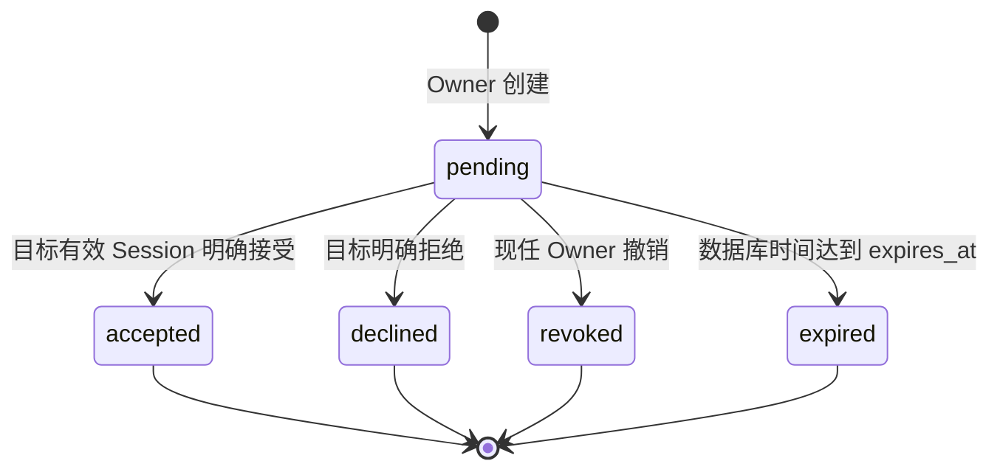

# Design

## Context

动机和范围见 [proposal.md](proposal.md)。2026-10-15 基线 `fbafb4a` 已完成第五 Change 合并、归档和主规格同步。Propose阶段仅写规划。随后用户于2026-10-15确认独立技术评审通过，正式授权Apply、不可复用membership_id、严格条件DELETE、Migration4、事务锁协议，以及完成后创建main PR；不得合并、归档或部署。

已观察源码：

- `workspace_members` 只有 `(workspace_id,user_id)` 复合主键、role、created_at，缺少表示一次加入的不可复用标识。
- `DeleteMember` 采用 READ COMMITTED，User `FOR SHARE` → Session `FOR SHARE` → Workspace `FOR NO KEY UPDATE` → 按 user_id 排序的 Membership `FOR UPDATE`，再以独立新语句的 `statement_timestamp()` 门控并按复合键删除。当前目标不存在也可向 Owner 返回 204。
- 用户/Session 保护、撤销、cleanup SKIP LOCKED、5s 请求/2s 整个数据库事务预算和未知 Commit 不自动重试均已建立。收件箱需要超越成员资格的、严格绑定接收者的只读邀请投影，不能放宽 Workspace detail/roster 权限。
- 现有测试中 v3 版本断言、三字段名单断言、旧 DELETE 调用以及临时 `00004_intentionally_bad.sql` 都会受影响；不能只追加新用例而留下旧套件失效。

## Goals / Non-Goals

**Goals:** 以有效 Session 下的明确同意原子加入；可证明的撤销/过期/重加边界；可恢复观察的终态；保护旧 DELETE 的关系代际；保持现有身份、最后 Owner 和租户隔离规则。

**Non-Goals:** 不把 UUID 当凭证，不新增登录方式或交付设施；不宣称任意特权 SQL、完整历史保留、exactly-once、时序恒定或公开环境防滥用已解决。不增加角色变更/Workspace 删除接口或邀请清理 Worker。完整业务排除项见 Proposal。

## Decisions

### D1. 产品模式比较与已确认规则

| 方式 | 产品体验/发现 | 安全、身份绑定、重放 | 隐私与成本 | 结论 |
| --- | --- | --- | --- | --- |
| Owner 输入用户 UUID，平台内收件箱 | 目标可从现有 auth/me 获取自己的 UUID，并经既有外部沟通告知 Owner；本轮不增加搜索；用户主动查询收件箱 | 目标 UUID 固定；只有该账户有效 Session 可以同意；邀请 ID 泄露不授予权限；终态不可重复加入 | Owner 必须预先知道 UUID；创建成功暴露有限可邀请性；无需交付系统或秘密存储 | **MVP 采用，用户已确认** |
| 绑定用户的外部邀请凭证 | Owner 仍需目标 UUID，另行复制/发送链接；无邮件系统时仍靠人工交付 | 仍必须校验目标 Session，不能拿到凭证即加入；需随机高熵秘密、仅存摘要、过期/单次使用，防 URL/历史/Referer/日志泄露 | 不解决 UUID 发现，反而增加凭证丢失、轮换和交付成本 | 本轮不采用，不预留 token 列 |
| 用户申请、Owner 审批 | 目标还需先发现 Workspace；Owner 处理审批积压 | 申请 Session 可表达同意，但审核与后续有效性是另一套协议；需防申请轰炸和 Workspace 枚举 | 需要 Workspace 发现/申请 API、拒绝规则和更多状态；可能暴露租户存在 | 独立未来产品能力 |

2026-10-15 用户在本会话确认：平台内定向邀请；固定 **7×24 小时**，不接受客户端 TTL/时间；每对 Workspace/目标最多一条 pending；重复创建、重复接受均 409；退出后必须新邀请；邀请属于 Workspace，发起者退出、失去 Owner 或被禁用**不自动失效**，任何现任 Owner 均可管理撤销；接受有限的 UUID 可邀请性泄露、统一拒绝原因、每 Workspace 最多 100 条未过期 pending 及公开前追加防滥用措施。

邀请的 `created_by_user_id` 仅作来源记录，不是持续授权条件。创建时必须为有效 Owner；接受时不要求发起者仍有角色、账户 active 或原 Session 存活。不得误把“接收者被禁用仍可加入”包含进此规则。最后 Owner 仍按关系数量计，至少一条 Owner 的不变量不保证 active Owner；出现 ownerless 损坏状态时写操作安全 500，不借邀请修复所有权。

### D2. 最小 API 与表示

保留六项操作以满足创建、发现、同意/拒绝和 Owner 管理，以及未知结果后的查询。不使用 `/auth/invitations`，因为邀请是业务资源。无单条 GET、批量邀请、重发、公开查询或 status PATCH。

| 方法与路径 | 请求 | 权限 | 成功 | 特有失败 |
| --- | --- | --- | --- | --- |
| POST `/api/v1/workspaces/{workspace_id}/invitations` | 唯一 JSON 字段 `invitee_user_id`，规范 UUID | 当前 active Owner + 有效 Session/CSRF | 201，`{data: OwnerInvitation}`；不设置 Location | 422 `invitee_unavailable`：不存在/disabled/自己/已有成员统一；409 `invitation_pending` 或 `invitation_limit_reached` |
| GET `/api/v1/workspaces/{workspace_id}/invitations` | `limit,after,status` | 当前 Owner | 200，`{data: OwnerInvitation[],pagination:{next_after}}` | 当前 Member 为 403 `invitation_forbidden`；非成员/未知 Workspace 同 404 |
| GET `/api/v1/invitations` | `limit,after,status` | 当前 active 用户有效 Session，仅本人收件箱 | 200，`{data: RecipientInvitation[],pagination:{next_after}}` | 无有效身份为 401；绝不接受 user_id/workspace_id 过滤 |
| POST `/api/v1/invitations/{invitation_id}/accept` | 空 body、无 query | 邀请接收者自己的 active Session + CSRF | 200，`{data:{invitation_id,workspace_id,membership_id,role:"member",joined_at}}`，确认 Commit 后返回 | 404 `invitation_not_found`；409 `invitation_not_pending` / `invitation_expired` / `already_member` |
| POST `/api/v1/invitations/{invitation_id}/decline` | 空 body、无 query | 同上 | 204，无 body | 同一邀请范围 404；非 pending 409 `invitation_not_pending`；已过期 409 `invitation_expired` |
| DELETE `/api/v1/invitations/{invitation_id}` | 空 body、无 query | 邀请所属 Workspace 的现任 Owner + CSRF | 204，表示 pending→revoked，保留记录 | 非现任 Owner、无邀请/越租户/非规范 UUID 同 404；非 pending/已过期同上述 409 |

OwnerInvitation **恰好**含 `id,workspace_id,invitee_user_id,created_by_user_id,status,created_at,updated_at,expires_at`。RecipientInvitation **恰好**含 `id,workspace_id,workspace_name,status,created_at,updated_at,expires_at`，不暴露发起者/其他接收者或任何邮箱/账户状态。仅有效 pending 的 workspace_name 为当前名称；accepted/declined/revoked/expired 历史的该字段固定 null，避免已撤销/过期邀请继续披露租户的新名称。接收者在有效 pending 时能看到这条邀请所属 Workspace 的当前名称与 UUID，是显式产品允许的最小例外，不能获取 detail、成员列表或其他邀请。历史可保留已知 Workspace UUID 和邀请状态供恢复观察；不借历史读取当前租户元数据。名称只作不可信 JSON 字符串。已有 Workspace DTO 完全不扩展。

列表：UUID `id ASC`；单一可选 `limit` 为规范十进制 1–100/默认50，`after` 为规范小写连字符 UUID，`status` 只允许 `pending`（默认）或 `all`。最多取 limit+1；next_after 仅在多一条时为最后已返回 id，否则 null。无 total；all 用于查询终态和未知结果恢复。不保证跨页快照，不因 cursor 检查资源存在。pending 过滤还必须 `expires_at > statement_timestamp()`；all 对超时的存储 pending 投影 effective expired。GET 不写数据库，也不因查列表批量置过期。

统一失败：`{error:{code,message}}`，不回显值、不添加动态解释。已有 400 `invalid_request`、401 `unauthenticated`、403 `csrf_rejected`、404 `workspace_not_found`、405 `method_not_allowed`、413 `request_too_large`、415 `unsupported_media_type`、503 `service_unavailable` / `database_timeout`、500 `internal_error` 保持既有固定消息。新增固定消息如下：

| code | message |
| --- | --- |
| invitee_unavailable | Invitee is not available. |
| invitation_forbidden | Invitation operation is not permitted. |
| invitation_not_found | Invitation not found. |
| invitation_pending | A pending invitation already exists. |
| invitation_limit_reached | Workspace invitation limit reached. |
| invitation_not_pending | Invitation is not pending. |
| invitation_expired | Invitation has expired. |
| already_member | Workspace membership already exists. |
| precondition_required | Membership precondition required. |
| precondition_failed | Membership precondition failed. |

合法集合但错误方法精确 Allow：Workspace invitations 为 `GET, POST`，个人收件箱为 `GET`，accept/decline 为 `POST`，邀请 item 为 `DELETE`，members 契约保留 `GET`/`DELETE`。HEAD 错误响应无 body，OPTIONS 405 无 CORS。路径额外段、空段、RawPath 编码别名、点段/重复斜杠不能经 ServeMux 重定向进入 mutation；扩展 `internal/app/routes.go` 的显式命名空间防护。

处理顺序：路径/方法 → mutation CSRF → Cookie 语法 → 有界请求结构/选择器 → DB 保护和最终活身份 → 作用域/权限 → 业务状态。未知/非规范 invitation ID 与不属于本人在 accept/decline 均相同404；revoke 只通过邀请与当前 Owner 成员关系联查确定范围，不能先给 Member 暴露邀请存在。创建/list 非成员在 Workspace 作用域失败404，Member 为403；目标是否可邀请只在 Owner 最终授权之后判断。语法错误可能先于 DB 身份失败，不承诺语法错误请求统一401。

创建 JSON 复用严格 4096-byte parser 策略：一对象、一字段、字符串；拒绝重复/未知/缺失/非字符串、非法 UTF-8/raw surrogate、多值和 Content-Encoding。Content-Type 仅 application/json 可带 UTF-8 charset。结构错误400、超长413、表示错误415；非规范 UUID 作为字段语义错误422 `invitee_unavailable`，不 trim。其余 mutation 空 body 检查采用既有单字节+实际读期限协议，非空400，无需 JSON Content-Type。请求 query 均严格白名单，包括非法 percent-encoding。所有响应 no-store/nosniff，不发 Set-Cookie；204 无 JSON Content-Type/Location，取消后不继续业务或尝试响应。

### D3. 权限矩阵

| 操作 | 当前 Owner | 当前 Member | 非成员/目标接收者 | 其他已登录用户 |
| --- | --- | --- | --- | --- |
| 创建、Workspace 邀请列表 | 允许 | 403 | 404 workspace_not_found | 同404 |
| 撤销 invitation item | 本 Workspace 内允许 | 同404 invitation_not_found | 同404 | 同404 |
| 自己的收件箱 | 仅本人收到的 | 仅本人收到的 | 仅本人收到的 | 仅本人收到的 |
| 接受/拒绝 | 只有自己是接收者 | 只有自己是接收者 | 仅自己的邀请 | 非自己的同404 |
| 同意前读取 Workspace detail/roster | 已有成员权限 | 已有成员权限 | 404 | 404 |
| 接受后访问 | 不新增 Owner | 新增固定 member | 按成员权限立即生效 | 无变化 |

Owner 权限不是替目标同意的权利。任何接口不接受 actor、workspace 授权声明或 role。邀请创建时目标无需当前 Session；只有接受/拒绝需要目标自己的有效 Session。active、未验证邮箱的既有账户可参加，此功能不声明邮箱所有权。

### D4. 数据模型与状态机

计划新增 `00004_create_workspace_invitations.sql`，一份事务 Goose migration：

| 对象/字段 | 设计 |
| --- | --- |
| `workspace_members.membership_id` | uuid NOT NULL，数据库 `uuidv7()` default，UNIQUE；一次加入的代际，不变且删除后不可复用；原复合 PK、FK、role CHECK、created_at/索引保留 |
| invitation `id` | uuid PK，数据库 uuidv7()；是公开资源标识，不是授权秘密 |
| `workspace_id` | 非空 FK workspaces，ON DELETE CASCADE（无公开删除接口） |
| `invitee_user_id` | 非空 FK users，ON DELETE RESTRICT；不可修改 |
| `created_by_user_id` | 非空 FK users，ON DELETE RESTRICT；Cookie 派生，不可修改，与 invitee 不同的 CHECK |
| `status` | 非空 text、默认 pending，CHECK 限 pending/accepted/declined/revoked/expired；终态不可由支持的 writer 回到 pending |
| `created_at,updated_at` | 非空 timestamptz，创建时同一数据库门控时间；后续只在迁移时改变 updated_at |
| `expires_at` | 非空 timestamptz，创建时间+604800秒；CHECK `expires_at>created_at`，`created_at<=updated_at<=expires_at`；有效窗口不含 expires_at |

无需 role 列、邮箱快照、邀请码、token 摘要、额外幂等表、Session FK 或 accepted membership FK。接受后的邀请保留，关系可以退出/移除；邀请不得因关系消失被重置或被 FK 级联删掉。状态转换由受支持的事务协议保护，普通 CHECK 不代表能阻止任意直接 SQL 把 accepted 改回 pending。UUID/时间等不可变列不开放更新入口。

唯一索引：`(workspace_id,invitee_user_id) WHERE status='pending'`，**不把 now()/statement_timestamp() 放进 partial index**。这限制存储 pending；重复创建先在同 Workspace 锁下将该对的过时 pending 迁为 expired，再插入新邀请。别的历史 expired/pending 不必扫描清理。不能用对整张表的 `(workspace_id,invitee_user_id)` 唯一约束阻止历史邀请或重加。

索引计划：`(workspace_id,id)` 支持 Owner all 列表，`(invitee_user_id,id)` 支持本人 all 列表；pending 部分索引分别 `(workspace_id,id) INCLUDE(expires_at)`、`(invitee_user_id,id) INCLUDE(expires_at)` 支持未过期列表；`(workspace_id,expires_at,id) WHERE status='pending'` 支持容量门控；created_by FK 单列索引用于受限删除检查。实现阶段以真实 PG18 计划验证，避免宣称 LIMIT 就能消除扫描成本。

先判断存储终态，再判断 pending 是否过期；已 accepted 的邀请超过原 expires_at 仍是 accepted。对 effective expired 的 GET，`status=expired,updated_at=expires_at`，与创建所指的其他时间字段一起确定性投影；持久化 lazy expiry 同样将 updated_at 置 expires_at。有效 pending 的接受/拒绝/撤销用最终门控时间置 updated_at。终态重复动作一律409 `invitation_not_pending`，expired 为409 `invitation_expired`，不反复更新 updated_at。不以204假装再次撤销成功，也不以200假装再次接受。

授权 mutation 触及过期 pending 时可原子持久化 expired，再经确认 Commit 返回409；数据库失败时返回503/500，不能忽略失败却声称状态已落库。GET 不写；无 worker 不影响过期生效。历史记录无自动 TTL 删除，增长容量和保留/清理策略留作公开部署前运维评审，不承诺永久审计。

创建前最终判断顺序：当前 Owner → target 可邀请性（unknown/disabled/self/already member 统一422）→ 现存有效 pending 409 → lazy-expire 该对过期pending → 有效pending数>=100则确认Commit后409，否则原子新建并确认Commit。有效pending重复409无需状态变更；Owner/目标失败回滚且不lazy-expire。冲突/超容量失败不产生新邀请；并发同 Workspace 创建由 Workspace 锁串行，不发生101条超限。未知提交后可由 Owner 的 all 列表观察，不自动重试；明确客户端再次创建在仍 pending 时409，原邀请已终态时允许产生新记录，不承诺请求去重。

### D5. 事务协议与全局锁顺序

所有邀请 mutation、条件 DELETE、受支持维护 writer 协调：

1. 使用 READ COMMITTED 开启事务，整个 pool/锁等待/语句/Commit 在2s内，请求5s。
2. 用 Cookie digest 只定位候选 actor user_id。accept/decline 候选 invitation 路由查询必须带 `invitee_user_id=actor`；revoke 候选须通过 actor 当前 Owner 关系联查。候选仅是定位，不能授权或返回数据。
3. **Users UUID 升序 `FOR SHARE`**：普通动作只 actor；创建还含目标账户，分开按 UUID 单行取锁，未知目标不会当作身份错误覆盖 Actor 401。所有 Users 锁先于任何 Session 锁；接受无需发起者 User 锁。即便角色为 Owner，也不在持 Workspace 锁后取得目标 User 锁。
4. **当前 Session `FOR SHARE`**，重新绑定 actor/token_hash，检查未撤销。失效/删除则401。登录沿用 User→Session；logout 只锁 Session，不反向索取 User；账户禁用/撤销全部 Session 的维护遵守 User→Session。
5. **Workspace `FOR NO KEY UPDATE`**。创建/list 之外的目标动作根据本人邀请范围取锁，不要求接收者已经是成员；revoke 要有当前 Owner 关系。不能复用“必须已有成员才能取 Workspace 锁”的 DeleteMember 查询来阻止首次加入。
6. **Memberships 按 user_id 升序 `FOR UPDATE`**：锁定存在的 actor/目标所需关系，检查当前角色；缺失关系没有行锁，用 Workspace 锁串行保护其空缺与未来插入。accept 锁本人已有关系（如存在），不锁发起者；新 owner-count 验证在 Workspace 锁保护下完成。
7. **Invitations 按 id 升序 `FOR UPDATE`**：创建锁本对 pending（至多1），accept/decline/revoke 锁目标邀请。显式拉取并 drain 所有锁结果。既有 DELETE 没有 invitation 锁，不能在持 Invitation 后回头取 Workspace/Membership。
8. **独立新语句的最终门控**：使用同一 `statement_timestamp()` 新快照重验 active actor、当前 Session owner/digest/unrevoked/严格未过期、Workspace存在、被保护的资源归属/当前权限和角色、Owner关系不变量、pending/expiry、重复关系、目标创建资格/配额或 DELETE If-Match。此后不得再取潜在阻塞的业务授权锁。INSERT/UPDATE 所需的约束/唯一索引隐式锁仍可能等待，预算覆盖它们，不能称数据库完全无等待。
9. accept 在同一事务将该 invitation pending→accepted 并 INSERT 固定 member（数据库生成新的 membership_id）。两条依赖语句也必须共享已确定的门控时间和决策；状态受锁保护，过期在门控后发生可提交。禁止无条件 ON CONFLICT UPDATE 现有角色，插入失败则回滚 accepted；其他动作只作允许的状态转换。成功结果须确认 Commit，错误或取消清理/丢弃连接。

对创建，目标 User 状态锁保护至提交；目标 Session 不需要也不可代替其未来同意。接受时目标就是 actor，User锁保护其 active；Session锁防撤销/cleanup；Workspace锁保护所有成员/邀请 writer；邀请锁防终态覆盖；Member锁及唯一复合键保护同一用户关系。外键隐式 KEY SHARE 不取代 active 检查。维护角色变化须先遵循 Users（如需要）→Session（如需要）→Workspace→Membership→Invitation；任意直接 SQL 不在证明范围。无公开角色/禁用 endpoint，本轮用合作的受控夹具验证。

接受的结果：

| 竞争 | 顺序 A | 顺序 B |
| --- | --- | --- |
| 两次接受同一邀请 | 第一次确认200并插入1关系，第二次409 not_pending | 调换获锁者，仍仅1关系 |
| 接受 vs 撤销 | accept先：200，revoke409 not_pending | revoke先：204，accept409 not_pending，无关系 |
| 接受 vs 拒绝 | accept先200，decline409 | decline先204，accept409，无关系 |
| revoke/disable 目标身份 vs accept | 身份变化先：401无写 | accept保护先：变化等待，accept可提交；之后fresh请求使用新状态 |
| Session/邀请在任一锁等待中到期 | 最终新语句检查严格 `>`，不允许加入 | 最终门控后到期可提交，锁不冻结时钟 |
| 发起者移除/降级/禁用 vs accept | 按已确认 Workspace 归属规则仍有效 | 任意现任 Owner 可与 accept 竞争撤销 |
| 创建者失去Owner vs创建/撤销者失权vs撤销 | 失权先：当前权限拒绝 | 业务锁先：角色变更等待，本次可完成 |
| 关系已存在 | 409 already_member，pending不变，无角色/时间覆盖 | 待旧关系删除后，仍有效的 pending 才能接受；常规产品流程创建时已排除已有成员 |
| 未知 Commit | 接口无成功、不重试、不补偿；可能两行都已提交或均未提交 | all 收件箱+Workspace/member list 恢复观察；accepted 不重放、不恢复已退出关系 |

### D6. 旧 DELETE 与重新加入：反例、方案、兼容性

**反例是对当前源码协议的推导，需要 PG18 红测试实证。** D_old 已进入请求甚至完成 User/Session 保护，在取得 Workspace 锁前暂停。D_remove 按同协议取得 Workspace 锁并删除关系 M1/提交；I_accept 随后取得锁创建 M2/提交；再恢复 D_old。其 Workspace 查询和后续新快照均看到 M2，当前代码只按 `(workspace_id,user_id)` 删除，于是 M2 被误删。D_old 若已持 Workspace 锁，另两事务确实不能插队，但“请求开始”不等于“已经持锁”。仅 SERIALIZABLE、锁 FIFO、入口读 membership_id、比较 joined_at、删除后继续返回204或禁止请求自动重试都不能保证重发/尚未读到旧代际的请求只作用于 M1。

选用客户端持有的关系代际条件，保持原 DELETE 路径、空 body 和 CSRF：

- GET members 增加 `membership_id`，四字段 `membership_id,user_id,role,joined_at`；排序/pagination仍按user_id，现有 Workspace DTO不变。
- DELETE 必须且仅允许一个强条件 `If-Match: "membership:<membership_id>:<role>"`，UUID规范，role为名单的owner/member；tag涵盖此关系代际及其role，created_at/user/workspace不可变。此为 member item 的validator，不能把整个 roster 的 ETag 当作它。未来增加可变成员字段必须重审 validator。
- 拒绝弱tag、`*`、多tag、重复header、非规范/空白夹杂/未知格式400；缺失header在通过当前身份/Workspace/操作权限之后返回428 `precondition_required`，不会给非成员先暴露目标。有效条件但关系缺失、代际或角色不匹配412 `precondition_failed`。Member删他人和Owner删其他Owner仍优先403；自己已退出仍404；匹配后才判断最后Owner409。只有实际删除匹配关系且确认Commit才204。
- 最终 SQL 删除条件同时包含 workspace_id、user_id、membership_id、role，并核对恰好1条，0条不得假成功；不按 id 单独绕过租户键。
- 旧条件M1在D_old最终门控只能匹配M1；M2有新UUID，所以412且M2保留。DELETE先持锁则删M1后accept新建M2；accept先/重加先则旧条件不能删M2。自退旧请求同样受保护；不承诺一个拥有**新**M2条件且仍有权限的请求不能移除M2，那是新的授权删除。

**BREAKING**：缺条件的旧客户端从可删变428，Owner重复删除/删除缺失从204变412，两Owner重复移除同M1从204/204变204/412。其状态幂等（不会再次改变关系）仍成立，响应不相同。客户端必须读名单，捕获当次关系条件，且不得在自动重试时偷偷刷新为M2；412提示重新观察并由用户明确决定新的移除。additive字段也会影响本项目精确DTO测试和严格客户端。

备选：membership_id新路径也能实现但增加旧路径禁用和路由迁移；内部入口读代际无法覆盖读取前延迟或重发；时间/version更易误用或仍需持久字段；长期禁止重加破坏业务目标。故提出If-Match方案，用户仅批准列入提案，独立评审已通过并明确授权本兼容性变更。

部署不能混用会无条件删除的旧二进制与开放接受的新二进制。维护窗口停止旧服务/排空请求 → 显式迁移4 → 原子切换至强制条件版本 → 验收后开放邀请；不能用“先迁移再滚动共存”声称安全。旧二进制回退同样不安全，因为数据库已经可能出现重加关系；紧急回退须停写/关闭邀请与成员DELETE，保留Schema并前向修复，不直接重开旧DELETE。

### D7. 最低安全要求和公开前措施

本轮：规范UUID不作秘密；所有对象访问先范围授权；固定同形404/422，無全局用户搜索/非Owner目标查找；Owner只得到有限可邀请性，不能声称零枚举。邀请ID在UUIDv7中有时间信息不代表身份；无token故无邀请凭证存储/URL泄露通路，Cookie仍沿用安全策略。重复pending/100条配额、严格body/list/time预算限制单次和同Workspace未完成堆积；它们不能阻止跨Workspace轰炸或撤销再邀。

公开部署前必须有独立发布验收：网关对账户/IP/Workspace的写入速率限制、对接收者跨Workspace的频次/冷却与拒绝后再邀策略、防注册/多租户绕过、容量/索引和历史保留清理评估、脱敏安全事件计数与异常监控/响应。阈值和责任人由发布评审确认，不在本Change实现HTTP监控/告警、Redis或完整通知。不能用内存限流冒充多实例防护，也不能仅凭随机UUID宣称不存在枚举。日志沿用固定安全reason，不记Cookie、hash、SQL、DSN、headers/body、邀请/成员/用户ID、Workspace名称或邮箱。

### D8. PostgreSQL 18 验收与 CI

未来 Apply 才执行下列计划；本次不把计划写成通过证据。

| 验收组 | 必须可复现的断言 |
| --- | --- |
| 产品闭环 | 注册/登录→建Workspace→创建→双方列表→接受/拒绝/撤销/过期；接受前无关系且detail/roster404；接受后member及现有读取/自退权限立即生效，不能移除他人或管理邀请 |
| 数据与重试 | 固定角色、防身份注入、5态终态不可逆、有效期边界、GET零写、单对pending、超时旧pending再邀、100与101竞争、已有member统一拒绝；终态重复动作409，旧accepted在退出后绝不重建关系 |
| 真并发 | accept/accept、accept/revoke、accept/decline、create/create、accept/remove、remove/self-exit/rejoin；每组双方先获锁顺序，含首事务回滚/已提交但丢回执 |
| DELETE代际 | 当前生产协议的红测试复现上述D_old先开始但后获锁的M2误删；新协议M1条件412/M2保留；另测D_old已持Workspace锁时重加阻塞；self-exit延迟重放、Owner重复删除204/412、两Owner退出保留1Owner |
| 身份/权限 | 目标Session撤销/cleanup/disabled及自然到期；Owner创建/撤销中的移除/降级；发起者失权/禁用后按确认策略仍可接受；每种User/Session/Workspace/Membership/Invitation锁等待后Session和邀请expiry门控 |
| 隔离/协议 | A/B租户、第三人/Owner冒充接收者、cursor替换、跨Workspace invitation id、UUID非规范、权限判断优先级、同形404/422、CSRF/method/编码/body注入、无Set-Cookie和安全日志；终态历史workspace_name=null且不能跟踪租户改名；真实TCP慢body/断开验证有界处理 |
| 故障/原子性 | 池/锁/语句超时、缺schema、Begin/保护/写入/Commit故障、确认回滚与真实Commit后注入EOF；邀请与关系两者一起存在或都不存在，Commit调用至多1，取消不响应，恢复后fresh请求正确 |
| Migration/回归 | 0→4、填充3→4、up/up、4→3→4（仅隔离库）、中途DDL故障原子回滚；旧数据/关系代际回填；1/2/3哈希；注册/登录/登出/me/Workspace/roster/DELETE/lastOwner/health完整回归 |

并发使用既有真实pgx连接屏障和`pg_blocking_pids`验证实际阻塞，不只sleep；业务时钟读取PG时间，不能靠应用时间猜到期。接受没有现存Membership可锁时也要验证Workspace锁对缺失关系的保护；不同租户无全局Workspace锁。Race Detector检测Go共享状态，不能替代数据库竞态测试。故障回执注入明确标注模拟，不冒充物理断网。

固定Go1.24.3、pgx/v5现有版本、Goose v3.26.0、CI现有PG18镜像digest。复用`internal/testdb`，只允许`devpilot_registration_test`并验证服务端18.x，禁止回退DATABASE_URL、连接应用库或读取开发.env；缺URL/PG18/Goose/连接均失败不skip。schema套件、普通integration和integration-race串行，单套件内部可用独立连接在稳定Schema上并发，不用t.Parallel改Schema。

CI未来扩展分支push触发（若Apply使用`codex/add-workspace-invitations`）且保留main PR两作业；verify跑format/vet/unit/race，integration跑串行PG18普通/race；命令沿用 `go test ./... -count=1`、`go test -race ./... -count=1`、`go test -tags=integration ./... -count=1 -timeout=120s`、`go test -race -tags=integration ./tests/integration -count=1 -timeout=120s`。如真实套件超预算，按证据调整CI总期限，不放宽业务预算。迁移故障fixture从固定版本4改为在当前最高版本之后的临时版本（预期5），并保留真正v3覆盖而非全局替换3→4。所有旧DELETE fixture需显式捕获目标代际，负向缺条件用例单独保留。

## Risks / Trade-offs

- [旧DELETE兼容性与混合部署] → 独立评审批准、调用方升级、排空旧二进制；没有安全双写兼容窗口，不静默保留无条件路径。
- [UUID人工交换摩擦与有限可邀请性泄露] → 用户已接受的MVP边界；平台不搜用户、不返回账户状态；公开前配套限流。
- [发起者失权后邀请仍可接受] → 用户已确认Workspace归属，任何现任Owner可查/撤销；明确不当作发起者持续授权。
- [无worker历史增长/过期pending物理残留] → effective状态保证即时失效，局部lazy expiry释放唯一键；保留/清理和大数据扫描由发布评审处理。
- [7天自然过期/门控后Session到期] → 数据库最终语句时刻是明确线性化边界；不许缓存身份或宣称锁能冻结时间。
- [未知提交及客户端反馈失败] → 无自动重试/补偿；all列表可观察终态，accepted不可重放；不声称所有未知请求都能凭列表唯一归因。
- [应用锁协议可被任意SQL绕过] → 受支持维护writer遵循同序锁；数据库PK/FK/CHECK保证局部完整性，不宣称RLS/数据库最后Owner强制或完整审计。

## Migration Plan

本节为已批准的迁移计划，实际隔离库验证见verification.md：追加版本4，为存量成员生成唯一membership_id并设默认/非空/唯一；用事务保证回填、约束、邀请表和Goose版本原子落库。按MVP小规模维护窗口评估表锁和回填耗时，不在事务Goose里混入CONCURRENTLY索引。

在隔离库验证4单步Down：先删除邀请表/索引，再移除membership_id新索引/列，保留所有v3成员的workspace/user/role/created_at及users/sessions；重新Up产生新的代际，旧validator失效是允许的测试行为。该Down丢失邀请/代际，只能在确认可丢弃库执行。生产/共享环境只串行status/up/status、保留数据、前向修复，API无自动DDL，readiness仍只Ping。

发布与回退必须遵循D6的停写/排空约束。迁移前备份、评估旧调用方、切换条件DELETE、验证收件箱/接受和回归，之后才开启业务入口；本轮不执行发布或创建PR。

## Review decisions and remaining gates

用户已确认D1所有产品规则及D7 MVP边界；2026-10-15另行确认独立评审通过并批准条件DELETE及Apply。没有待猜测的产品分支；若评审更改TTL、配额、发起者规则或终态语义，必须先同步Proposal/Design/delta/tasks，不能直接进入Apply。Migration4、锁协议/真实PG测试、validator兼容性已获Apply批准；实际执行和未部署边界记录于verification.md。公开部署反滥用阈值、保留期限和运营责任属于后续发布，不影响本轮私有MVP验收。

## References

数据库协议是基于当前源码及以下主资料的设计推导，必须用D8的PG18实验验证，资料本身不证明本项目实现已安全：

- [PostgreSQL 18 Explicit Locking](https://www.postgresql.org/docs/18/explicit-locking.html)：行锁冲突、持锁范围与一致锁顺序。
- [PostgreSQL 18 Read Committed](https://www.postgresql.org/docs/18/transaction-iso.html#XACT-READ-COMMITTED)：逐语句快照是旧DELETE反例与最终新语句门控的依据。
- [PostgreSQL 18 CREATE INDEX](https://www.postgresql.org/docs/18/sql-createindex.html)：partial唯一索引和immutable限制；不能把当前时间放入索引谓词。
- [RFC 9110 If-Match](https://www.rfc-editor.org/rfc/rfc9110.html#name-if-match) 与 [RFC 6585 428](https://www.rfc-editor.org/rfc/rfc6585.html#section-3)：强条件、412及要求条件请求的428。严格单tag语法是本API的收窄契约。

## Planning validation record

2026-10-15 实际执行 `openspec validate add-workspace-invitations --strict` 通过，状态为4/4规划产物齐备；四份delta共26个Requirement、122个Scenario，29项实施任务全部未勾选。另检查所有MODIFIED块保留原Scenario标题，并具有成功/异常/安全/并发覆盖，新增文本无尾随空白。

`openspec validate --all --strict` 为9通过/1失败：既有 `user-authentication` 主规格 requirements[11] 描述超过500字符的warning在strict下失败。已逐字节确认该文件与HEAD相同，本Change没有修改它；不把新Change通过说成全库通过。`git diff --check`通过，tracked文件无差异；本次Git新增仅为本Change的8份规划文件（包括CLI生成的.openspec.yaml），未运行Go/PG测试、编写业务/迁移SQL、操作数据库、提交Git或创建PR。本文的数据库实验和CI结果仍全部是待Apply后执行的计划。
